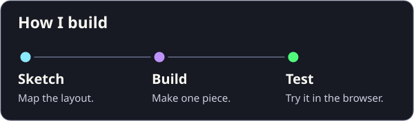

<h1 align="center">Hi, I’m Kadir 👋</h1>

  I’m learning frontend development with HTML, CSS, and JavaScript. 
  I build things step by step. If I can’t explain a line of code in my own words, I take another look.

  

## Toolbox

  
  
  
  
  
  
  
  
  

**Currently learning:** Responsive layouts and working with data in JavaScript.

  

## GitHub activity

  

  

  <a href="https://www.linkedin.com/in/kad%C3%ACr-cetin-826a6b385/">Connect with me on LinkedIn</a>

